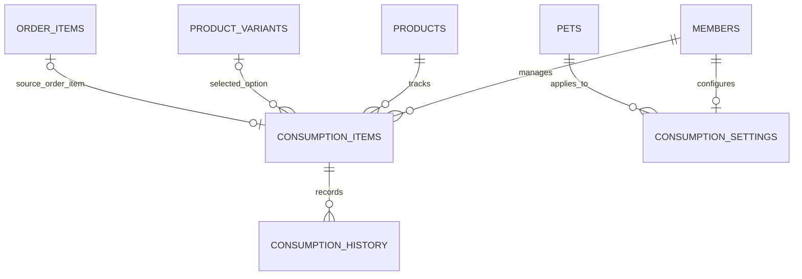

# POWCAST 소진일 관리 백엔드·DB 연동 제안서

## 1. 목적

회원이 구매하거나 직접 등록한 사료·영양제의 현재 잔량과 하루 사용량을 관리하고 예상 소진일을 계산한다. 프런트엔드의 `/mypage/consumption` 화면과 Spring Boot API를 연결하기 위한 기준 문서다.

## 2. 현재 프런트엔드 구조

- 화면: `src/views/ConsumptionManagementView.vue`
- 상태: `src/stores/consumption.js`
- API 어댑터 초안: `src/services/consumptionService.js`
- 현재는 `localStorage`를 사용한다.
- 백엔드 연동 시 Store 액션 내부를 `consumptionService` 호출로 교체한다.
- 프런트에서 전달한 회원 ID는 신뢰하지 않고 JWT의 회원 ID를 사용한다.

## 3. 제안 테이블

### 3.1 CONSUMPTION_ITEMS

회원이 소진일을 관리하는 상품 단위 데이터다.

| 컬럼             | 타입          | 제약조건                       | 설명                                |
| ---------------- | ------------- | ------------------------------ | ----------------------------------- |
| id               | BIGINT        | PK                             | 관리 항목 ID                        |
| member_id        | BIGINT        | FK → MEMBERS.id, NOT NULL      | 소유 회원                           |
| product_id       | BIGINT        | FK → PRODUCTS.id, NOT NULL     | 상품                                |
| variant_id       | BIGINT        | FK → PRODUCT_VARIANTS.id, NULL | 구매 옵션                           |
| order_item_id    | BIGINT        | FK → ORDER_ITEMS.id, NULL      | 주문에서 등록한 경우 원본 주문 항목 |
| opened_at        | DATE          | NOT NULL                       | 개봉일                              |
| initial_amount   | NUMERIC(12,2) | NOT NULL                       | 등록 당시 총량                      |
| remaining_amount | NUMERIC(12,2) | NOT NULL                       | 현재 잔량                           |
| daily_amount     | NUMERIC(12,2) | NOT NULL                       | 하루 사용량                         |
| amount_unit      | VARCHAR(20)   | NOT NULL                       | `G`, `ML`, `TABLET`, `COUNT`        |
| status           | VARCHAR(20)   | NOT NULL                       | `ACTIVE`, `CONSUMED`, `ARCHIVED`    |
| created_at       | TIMESTAMPTZ   | NOT NULL                       | 생성 일시                           |
| updated_at       | TIMESTAMPTZ   | NOT NULL                       | 수정 일시                           |
| deleted_at       | TIMESTAMPTZ   | NULL                           | 소프트 삭제 일시                    |

권장 인덱스:

```sql
CREATE INDEX idx_consumption_items_member_status
    ON consumption_items(member_id, status);

CREATE INDEX idx_consumption_items_member_product
    ON consumption_items(member_id, product_id);
```

검증 규칙:

- `initial_amount > 0`
- `remaining_amount >= 0`
- `daily_amount > 0`
- `remaining_amount <= initial_amount`가 기본값이지만 사용자가 재충전한 경우 정책에 따라 허용할 수 있다.
- `order_item_id`를 전달하면 해당 주문이 JWT 회원의 주문인지 검증한다.
- 상품과 옵션이 판매 중지되어도 기존 소진일 기록은 조회할 수 있어야 한다.

### 3.2 CONSUMPTION_SETTINGS

회원별 기본 계산 설정이다.

| 컬럼                 | 타입          | 제약조건            | 설명               |
| -------------------- | ------------- | ------------------- | ------------------ |
| member_id            | BIGINT        | PK, FK → MEMBERS.id | 회원               |
| pet_id               | BIGINT        | FK → PETS.id, NULL  | 설정 대상 반려동물 |
| pet_weight_kg        | NUMERIC(6,2)  | NULL                | 체중               |
| default_daily_amount | NUMERIC(12,2) | NULL                | 기본 하루 급여량   |
| default_daily_count  | INT           | NULL                | 하루 급여 횟수     |
| updated_at           | TIMESTAMPTZ   | NOT NULL            | 수정 일시          |

반려동물별 설정이 필요하면 PK를 `(member_id, pet_id)` 복합키로 사용한다.

### 3.3 선택 테이블: CONSUMPTION_HISTORY

잔량 수정 이력을 감사하거나 사용 패턴을 분석해야 할 때만 추가한다.

| 컬럼                | 타입          | 설명                                                            |
| ------------------- | ------------- | --------------------------------------------------------------- |
| id                  | BIGINT PK     | 이력 ID                                                         |
| consumption_item_id | BIGINT FK     | 관리 항목                                                       |
| change_type         | VARCHAR(30)   | `CREATED`, `AMOUNT_UPDATED`, `DAILY_AMOUNT_UPDATED`, `CONSUMED` |
| amount_before       | NUMERIC(12,2) | 변경 전 잔량                                                    |
| amount_after        | NUMERIC(12,2) | 변경 후 잔량                                                    |
| created_at          | TIMESTAMPTZ   | 발생 일시                                                       |

초기 개발 범위에서는 생략할 수 있다.

## 4. 테이블 관계



## 5. API 제안

모든 API는 회원 JWT가 필요하다.

| API ID | Method | URL                                                               | 설명                         |
| ------ | ------ | ----------------------------------------------------------------- | ---------------------------- |
| CNS-01 | GET    | `/api/members/me/consumption-items`                               | 활성 관리 상품 목록 조회     |
| CNS-02 | POST   | `/api/members/me/consumption-items`                               | 관리 상품 직접 등록          |
| CNS-03 | PATCH  | `/api/members/me/consumption-items/{itemId}`                      | 잔량·하루 사용량·개봉일 수정 |
| CNS-04 | DELETE | `/api/members/me/consumption-items/{itemId}`                      | 관리 항목 소프트 삭제        |
| CNS-05 | GET    | `/api/members/me/consumption-settings`                            | 회원 계산 기준 조회          |
| CNS-06 | PUT    | `/api/members/me/consumption-settings`                            | 회원 계산 기준 저장          |
| CNS-07 | POST   | `/api/members/me/consumption-items/from-order-item/{orderItemId}` | 구매 상품으로 관리 항목 생성 |

### 5.1 목록 조회 응답

```json
{
  "items": [
    {
      "id": 31,
      "productId": 102,
      "variantId": 405,
      "orderItemId": 9001,
      "productName": "로얄캐닌 미니 어덜트",
      "imageUrl": "/assets/products/royal-canin.jpg",
      "categoryName": "사료",
      "openedAt": "2026-11-10",
      "initialAmount": 2000,
      "remainingAmount": 1240,
      "dailyAmount": 80,
      "amountUnit": "G",
      "estimatedDaysRemaining": 16,
      "estimatedExhaustedAt": "2026-12-01",
      "status": "ACTIVE",
      "updatedAt": "2026-11-15T14:20:00+09:00"
    }
  ]
}
```

### 5.2 직접 등록 요청

```json
{
  "productId": 102,
  "variantId": 405,
  "openedAt": "2026-11-10",
  "initialAmount": 2000,
  "remainingAmount": 2000,
  "dailyAmount": 80,
  "amountUnit": "G"
}
```

응답은 생성된 항목 전체와 HTTP `201 Created`를 반환한다.

### 5.3 관리 항목 수정 요청

```json
{
  "openedAt": "2026-11-10",
  "remainingAmount": 1200,
  "dailyAmount": 75,
  "amountUnit": "G"
}
```

PATCH 요청에는 변경할 필드만 전달할 수 있어야 한다.

### 5.4 계산 기준 저장 요청

```json
{
  "petId": 12,
  "petWeightKg": 5.2,
  "defaultDailyAmount": 36,
  "defaultDailyCount": 2
}
```

## 6. 계산 책임

예상 소진일은 화면 표시 편의를 위해 프런트에서도 계산할 수 있지만 최종 값은 서버가 계산한다.

```text
estimatedDaysRemaining = ceil(remainingAmount / dailyAmount)
estimatedExhaustedAt = 기준 날짜 + estimatedDaysRemaining
```

- `dailyAmount`가 0 이하인 요청은 `400 Bad Request`로 거절한다.
- 시간대는 서버 저장 시 `TIMESTAMPTZ`, 날짜 응답은 ISO 8601을 사용한다.
- 단위가 다른 값끼리 계산하지 않는다.
- 서버 응답의 예상 일수를 프런트 표시 기준으로 사용한다.

## 7. 재구매 처리

재구매는 소진일 전용 주문 API를 만들지 않는다. 관리 항목의 `variantId`와 수량을 사용해 기존 장바구니 API를 호출한다.

```http
POST /api/cart/items
```

```json
{
  "variantId": 405,
  "quantity": 1
}
```

상품이 판매 중지·품절이면 장바구니 추가를 거절하고 사용자에게 사유를 반환한다.

## 8. 오류 응답 권장 형식

```json
{
  "code": "CONSUMPTION_ITEM_NOT_FOUND",
  "message": "관리 중인 상품을 찾을 수 없습니다.",
  "fieldErrors": []
}
```

권장 오류 코드:

- `CONSUMPTION_ITEM_NOT_FOUND`
- `CONSUMPTION_ITEM_FORBIDDEN`
- `INVALID_CONSUMPTION_AMOUNT`
- `INVALID_CONSUMPTION_UNIT`
- `ORDER_ITEM_NOT_OWNED`
- `PRODUCT_NOT_AVAILABLE`

## 9. 백엔드 구현 순서

1. `CONSUMPTION_ITEMS`, `CONSUMPTION_SETTINGS` 마이그레이션 작성
2. Entity 및 Repository 작성
3. 회원 소유권 검증을 포함한 Service 작성
4. CNS-01~CNS-06 구현
5. 주문 항목에서 등록하는 CNS-07 구현
6. 기존 장바구니 API를 이용한 재구매 연결
7. 단위·잔량·하루 사용량 검증 테스트
8. 프런트 Store의 localStorage 코드를 Service 호출로 교체

## 10. 프런트 전환 체크리스트

- `useConsumption`의 `seed()` 제거
- 진입 시 `consumptionService.getItems()` 호출
- 추가·수정 성공 후 서버 응답으로 Store 갱신
- 요청 중 버튼 중복 클릭 방지
- 로딩, 빈 데이터, 400, 401, 403, 404 상태 표시
- 재구매는 `cartService.addItem()` 호출
- 서버가 반환한 `estimatedDaysRemaining`과 `estimatedExhaustedAt` 표시
- 개발 완료 후 기존 `powcast-consumption-*` localStorage 데이터 제거 또는 마이그레이션

## 11. 명세에 추가할 API 개수

소진일 관리 API ID 접두어는 `CNS`를 권장하며 총 7개다. Spring Boot API 총개수에도 7개를 추가해야 한다.
